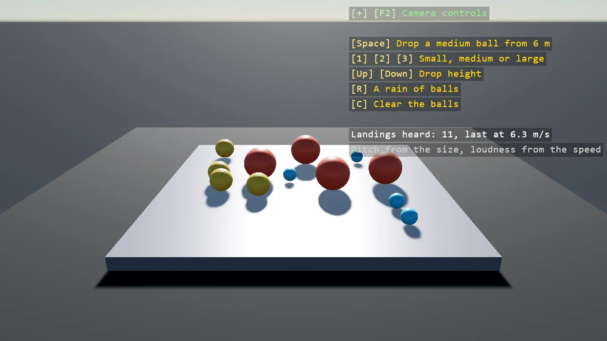

# Impact Sounds

Balls of three sizes drop onto a plate and every landing is heard. The plate's contact handler
reads the ball's pre-step speed along the contact normal and queues a note for the audio thread, its
pitch from the ball's size and its loudness from the speed; a procedural sound mixes up to
sixteen decaying tones. The handler runs with the physics step and the mixer on the audio
worker thread, so the notes cross between them through a ConcurrentQueue.

The `Program.cs` file shows how to:

- A contact handler on a static plate, reading the other body's PreviousLinearVelocity along the contact normal
- A note's pitch from the collider's radius and its loudness from the speed
- A procedural sound that mixes several decaying tones per block
- A ConcurrentQueue as the one thing the physics side and the audio thread share
- Using helpers: SceneSetup3D, UseBepu, UseSkybox, CreatePrimitive, CreateMaterial, CreateProceduralSound, ShapeBatch, TextOverlay

View on [GitHub](https://github.com/stride3d/stride-community-toolkit/tree/main/examples/code-only/E12_Audio_Impacts).

[!code-csharp]