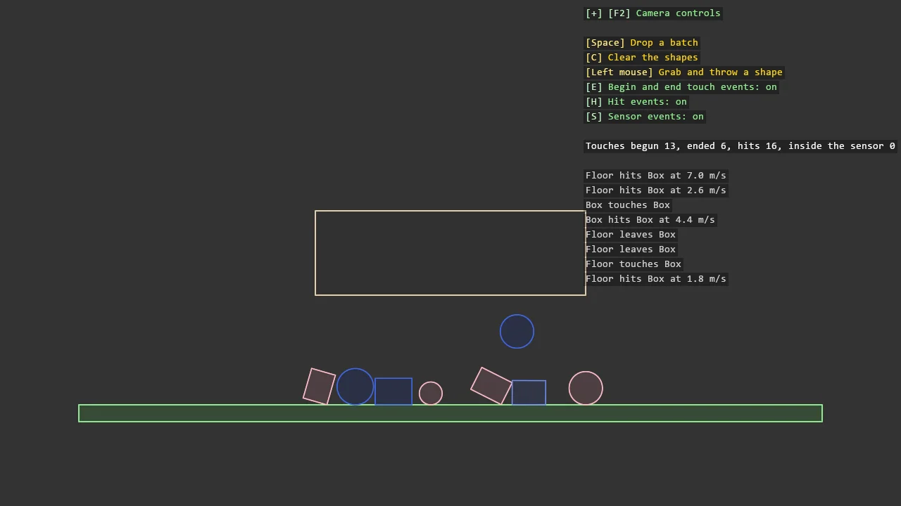

# Box2D Events

Shapes drop through a sensor zone onto a floor and one handler listens to everything Box2D
reports: begin and end touch, hits with their approach speed, and a sensor's visitors. Every
kind is opt-in on the shape definition, where the library's defaults are all off, and switched
on the simulation as well; the keys flip the simulation's switches to show which lines of the
log each one owns. A shape inside the sensor turns gold and a hit shape flashes.

The `Program.cs` file shows how to:

- IContactEventHandler and ISensorEventHandler registered on the Box2DSimulation
- enableContactEvents, enableHitEvents and enableSensorEvents on the shape definition, all off by default
- A sensor shape that detects and never collides
- The hit event's approach speed as a measure of the impact
- Using helpers: SceneSetup2D, Box2DSimulation, ShapeFixtureBuilder, ShapeComponent, AddGrabber2D, TextOverlay

> [!NOTE]
> This example references `Stride.CommunityToolkit.Box2D`, which is not on NuGet yet. Run it from a clone of the
> repository, where the package is a project reference; a copy of the project on its own will not build.

View on [GitHub](https://github.com/stride3d/stride-community-toolkit/tree/main/examples/code-only/E06_Box2D_Events).

[!code-csharp]