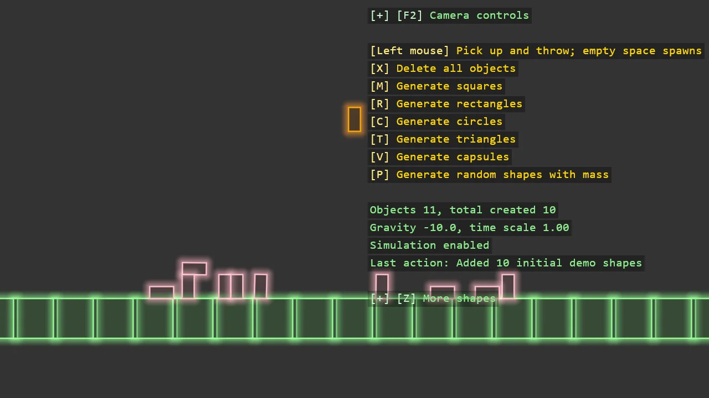

# Box2D.NET Physics

A 2D simulation run by Box2D.NET rather than by Stride's own physics, with Stride reduced to drawing
the result. That split is the whole lesson: the physics world steps on a fixed timestep of its own,
and entity transforms are copied from body poses afterwards, so nothing in the scene graph is
allowed to move a body directly. The same pattern applies to any external simulation you want to
drive a Stride scene with.

The `Program.cs` file shows how to:

- Hosting an external physics world alongside Stride
- Stepping a simulation on a fixed timestep, independent of frame rate
- Creating dynamic and static bodies in Box2D
- Copying body poses onto entity transforms each frame
- Why the scene graph must not write back to the simulation
- Requires the Box2D.NET NuGet package

> [!NOTE]
> This example references `Stride.CommunityToolkit.Box2D`, which is not on NuGet yet. Run it from a clone of the
> repository, where the package is a project reference; a copy of the project on its own will not build.

View on [GitHub](https://github.com/stride3d/stride-community-toolkit/tree/main/examples/code-only/E06_Box2D).

[!code-csharp]