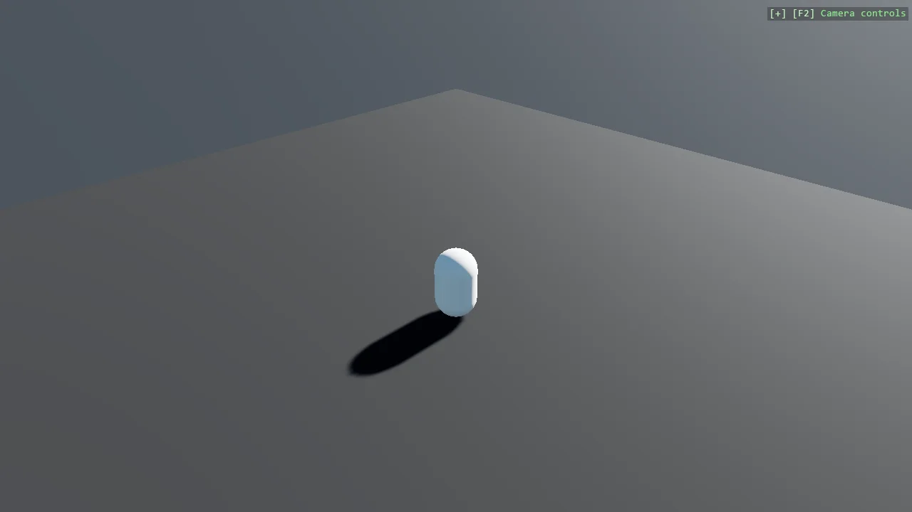

# Basic 3D Scene (Capsule)

Create a minimal 3D scene using toolkit helpers, add a skybox, and place a single capsule primitive.
Demonstrates primitive creation, basic positioning, and attaching the entity to the scene.

The `Program.cs` file shows how to:

- Creating a 3D primitive with CreatePrimitive
- Positioning an entity with Transform.Position
- Adding entities to a Scene (rootScene)
- Using helpers: SceneSetup3D, UseSkybox

View on [GitHub](https://github.com/stride3d/stride-community-toolkit/tree/main/examples/code-only/E01_3D_BasicScene).

[!code-csharp]