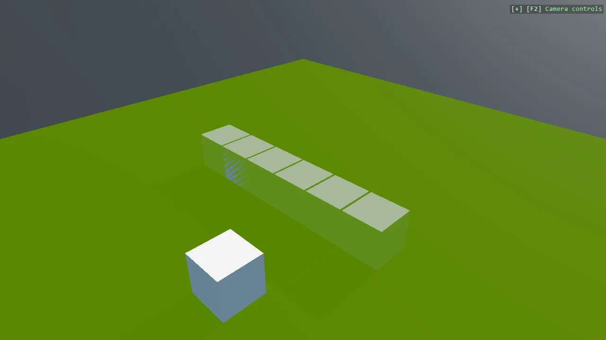

# Collidable Gizmo

A single-purpose demo of CollidableGizmoScript, which draws the collider Bepu is actually using so
it can be compared against the model you think you gave it. The script draws every collider in the
scene, so it sits on an empty entity of its own. The cube beside the row is created with
IncludePhysics set to false, which makes the point directly: the gizmo reports what physics knows
about, and if nothing is drawn, nothing is there.

The `Program.cs` file shows how to:

- Drawing the collider a body is really using
- Hosting a scene-wide script on an empty entity
- Leaving physics out with IncludePhysics = false
- Showing or hiding the gizmo with its Visible property
- Diagnosing a body that does not collide as expected
- The one-call form for a whole scene: game.AddPhysicsDebug()
- Using helpers: SceneSetup3D, AddSkybox, AddProfiler, CreatePrimitive, AddGrabber

View on [GitHub](https://github.com/stride3d/stride-community-toolkit/tree/main/examples/code-only/E08_3D_CollidableGizmo).

[!code-csharp]