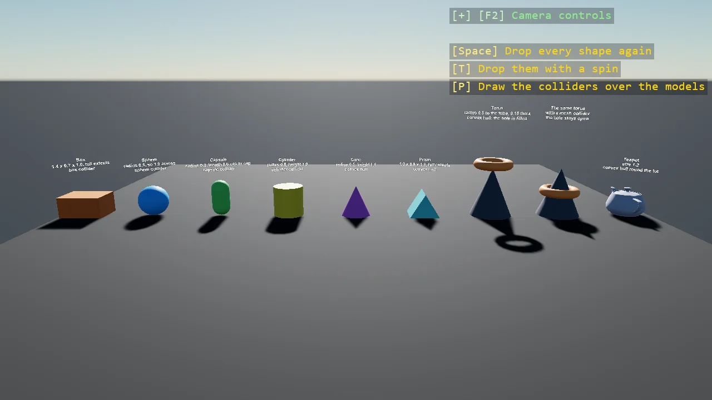

# Collider Shapes

One of every primitive shape dropped side by side, each with the collider the toolkit fits to it:
a box, a sphere, a capsule and a cylinder get their own kinds, and the cone, prism, torus and
teapot get one convex hull each, which fills the torus. The label over each shape says what its numbers mean, a full extent for
the box-like shapes and a radius for the round ones, and P draws the colliders over the models.

The `Program.cs` file shows how to:

- One shape builds both the model and the collider, so the two agree by construction
- Which shapes have a Bepu primitive and which become one convex hull around every vertex
- What Size, Radius, Length and Height mean on each shape
- The collider gizmos from AddPhysicsDebug, toggled with P
- Using helpers: SceneSetup3D, UseBepu, UseSkybox, CreatePrimitive, CreateMaterial, AddPhysicsDebug, TeleportAtRest, TextOverlay

View on [GitHub](https://github.com/stride3d/stride-community-toolkit/tree/main/examples/code-only/E05_3D_ColliderShapes).

[!code-csharp]