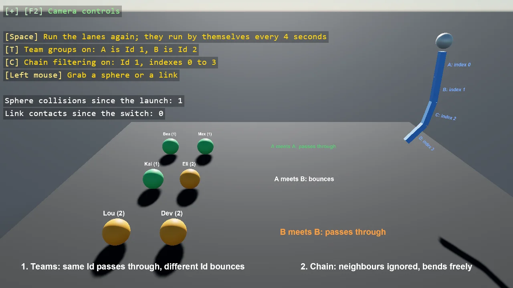

# Collision Group

Two players and an enemy, where the players collide with each other but the enemy passes through
both. Bepu collision groups decide this arithmetically rather than by a table: bodies in the same
group collide only when their index values differ by more than a set amount. Here the players sit at
0 and 2 and the enemy at 1, so the players interact and the enemy is transparent to them.

The `Program.cs` file shows how to:

- Assigning bodies to a collision group
- How the IndexA difference rule decides whether two bodies collide
- Choosing index values so one entity phases through others
- When an arithmetic rule beats a full collision matrix
- Using helpers: SceneSetup3D, UseSkybox, CreatePrimitive, CreateMaterial

View on [GitHub](https://github.com/stride3d/stride-community-toolkit/tree/main/examples/code-only/E05_3D_CollisionGroup).

[!code-csharp]