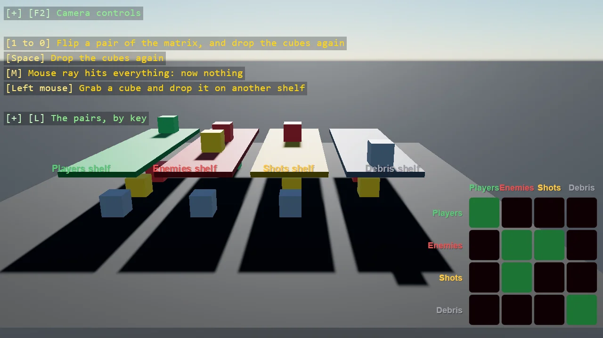

# Collision Layer

The same players-and-enemy scene as the collision group example, solved the other way. Layers name
the categories - players, enemies, ground - and a matrix says which pairs interact, so both players
collide with each other and the ground while the enemy ignores the players but still lands on the
floor. Layers are the readable choice when the rules are per-pair; groups win when they follow a
formula.

The `Program.cs` file shows how to:

- Defining named collision layers
- Filling in the collision matrix pair by pair
- Letting one entity phase through another while both keep colliding with the ground
- When to prefer a layer matrix over an index rule
- Using helpers: SceneSetup3D, UseSkybox, CreatePrimitive, CreateMaterial

View on [GitHub](https://github.com/stride3d/stride-community-toolkit/tree/main/examples/code-only/E05_3D_CollisionLayer).

[!code-csharp]