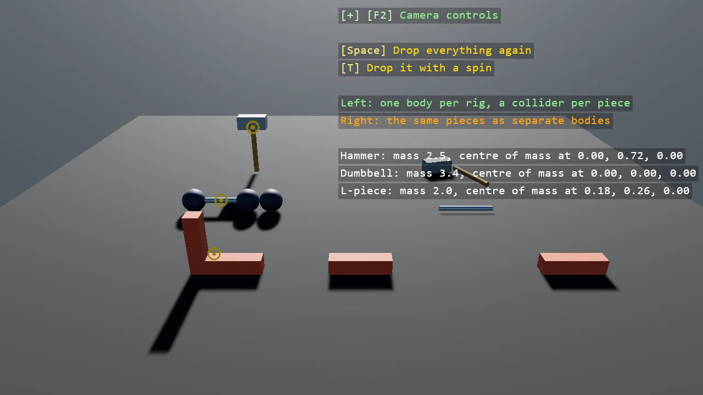

# Compound Colliders

A hammer, a dumbbell and an L-piece, each one body whose compound collider holds a collider per
piece at its own local pose and mass, beside the same pieces dropped as separate bodies. The
compounds land whole and turn about the centre of mass their masses decide, marked with a ring;
the loose pieces come apart. The pieces' models are child entities riding on the body's transform.

The `Program.cs` file shows how to:

- A CompoundCollider with several child colliders, each with PositionLocal, RotationLocal and Mass
- The body's mass as the sum, and CenterOfMass where the masses put it
- Models as child entities of the body, so one transform moves the lot
- The same pieces as separate bodies for the contrast
- Using helpers: SceneSetup3D, UseBepu, UseSkybox, CreatePrimitive, ColliderFor, CreateMaterial, TeleportAtRest, ShapeBatch, TextOverlay

View on [GitHub](https://github.com/stride3d/stride-community-toolkit/tree/main/examples/code-only/E05_3D_CompoundColliders).

[!code-csharp]