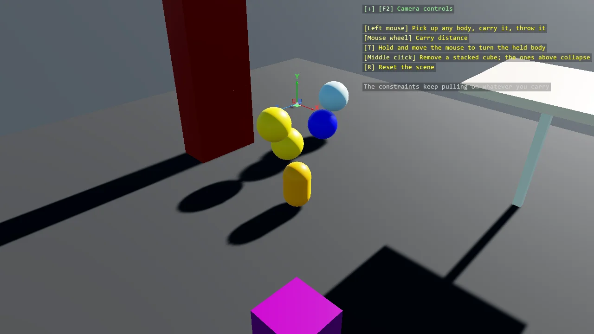

# Various Constraints

The full tour of Bepu constraints in one interactive scene: a distance limit holding two spheres
within a range, a distance servo actively driving a separation with spring settings, a ball socket
pivoting a platform on a kinematic foundation, and point-on-line servos confining cubes to vertical
tracks. It is meant to be played with - pick up any body with the mouse and throw it while its
constraints keep pulling, middle-click a cube to remove it so the stack above collapses, R resets
everything.

The `Program.cs` file shows how to:

- Picking up and throwing constrained bodies with GrabberScript
- Limiting a range with DistanceLimitConstraintComponent
- Driving a target separation with DistanceServoConstraintComponent
- Pivoting a body with BallSocketConstraintComponent
- Confining motion to an axis with PointOnLineServoConstraintComponent
- Tuning a servo with spring frequency and damping
- Anchoring a constraint to a kinematic foundation
- Filtering collisions between the connected parts
- Removing constrained bodies at runtime and resetting the scene
- Using helpers: SceneSetup3D, UseSkybox

View on [GitHub](https://github.com/stride3d/stride-community-toolkit/tree/main/examples/code-only/E05_3D_Constraints).

[!code-csharp]