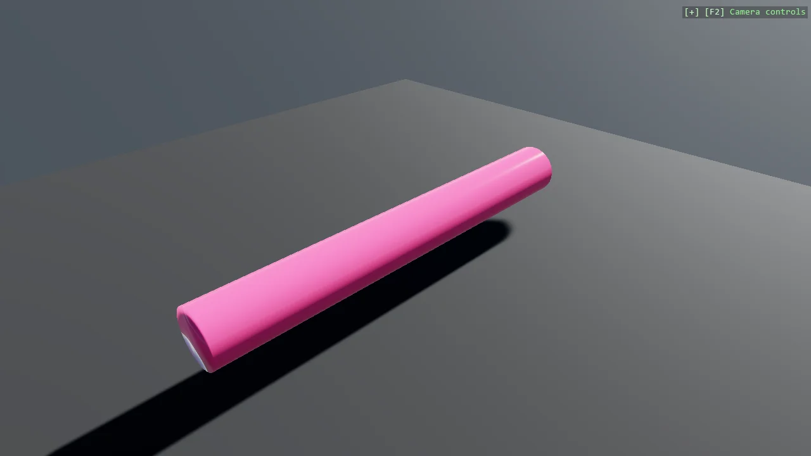

# Cylinder Mesh

A cylinder generated with MeshBuilder, split into the three jobs any surface of revolution needs:
place a ring of vertices, join consecutive rings into side walls, then close both ends with caps.
Separating them is what keeps the index arithmetic followable - the caps in particular wind the
opposite way to each other, which is easy to get wrong and instantly visible when you do.

The `Program.cs` file shows how to:

- Generating a ring of vertices from an angle sweep
- Stitching consecutive rings into a quad strip of triangles
- Closing the ends with fan-triangulated caps
- Why the two caps must wind in opposite directions
- Keeping index arithmetic readable by splitting the build into stages
- Using helpers: SceneSetup3D, UseSkybox

View on [GitHub](https://github.com/stride3d/stride-community-toolkit/tree/main/examples/code-only/E07_3D_CylinderMesh).

[!code-csharp]