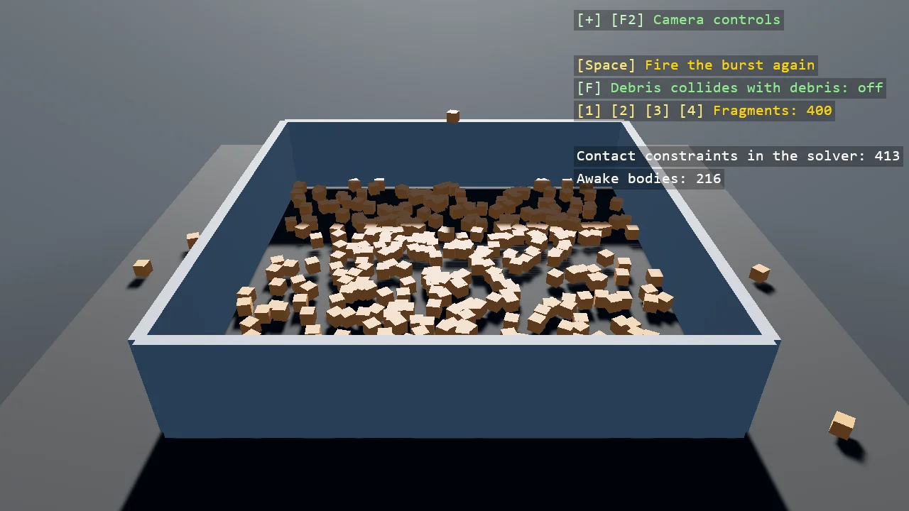

# Debris Filtering

A burst of a few hundred fragments lands in a walled pit. On a layer the collision matrix does
not pair with itself the fragments pass through each other and settle in one flat layer; with
the pair on they pile up, and the solver pays for every contact between them. The overlay counts
the contact constraints and the awake bodies, and the profiler shows the step time move with
them: the first reason to filter is a saving, for collisions nobody would see.

The `Program.cs` file shows how to:

- One pair of the collision matrix, a layer against itself, flipped at runtime
- Reading the contact constraint and active body counts from the Bepu simulation
- The step time in the profiler as the cost of contacts
- One shared model for every fragment, through ShareModel
- Using helpers: SceneSetup3D, UseBepu, UseSkybox, CreatePrimitive, CreateMaterial, GetSimulation, TextOverlay

View on [GitHub](https://github.com/stride3d/stride-community-toolkit/tree/main/examples/code-only/E05_3D_DebrisFiltering).

[!code-csharp]