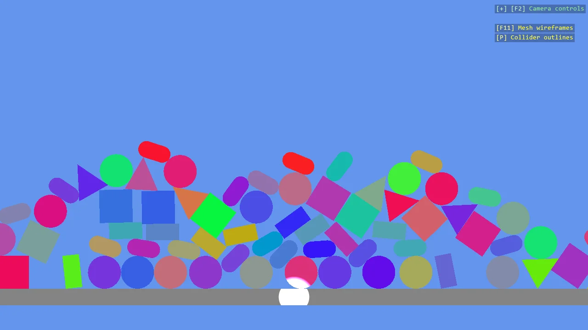

# Basic 2D Scene (Debug Rendering)

A pile of falling 2D shapes with the physics text overlays turned on, so what the simulation is
actually solving can be seen rather than inferred. P draws the colliders and F11 draws the debug
meshes. Both come from AddPhysicsDebug, one entity with the two scripts; each acts on the whole
scene, so one entity is all any scene needs. A spot light is included because 2D scenes are lit like
any other and look flat without one.

The `Program.cs` file shows how to:

- Both debug views on one entity with AddPhysicsDebug, the colliders on P and the debug meshes on F11
- Why one entity is enough, since CollidableGizmoScript and DebugRenderComponentScript act on the whole scene
- Lighting a 2D scene with a LightSpot
- Giving each shape its own colour with a flat material
- Using helpers: SceneSetup2D, CreatePrimitive, CreateFlatMaterial, AddPhysicsDebug, AddGrabber

View on [GitHub](https://github.com/stride3d/stride-community-toolkit/tree/main/examples/code-only/E08_2D_DebugRender).

[!code-csharp]