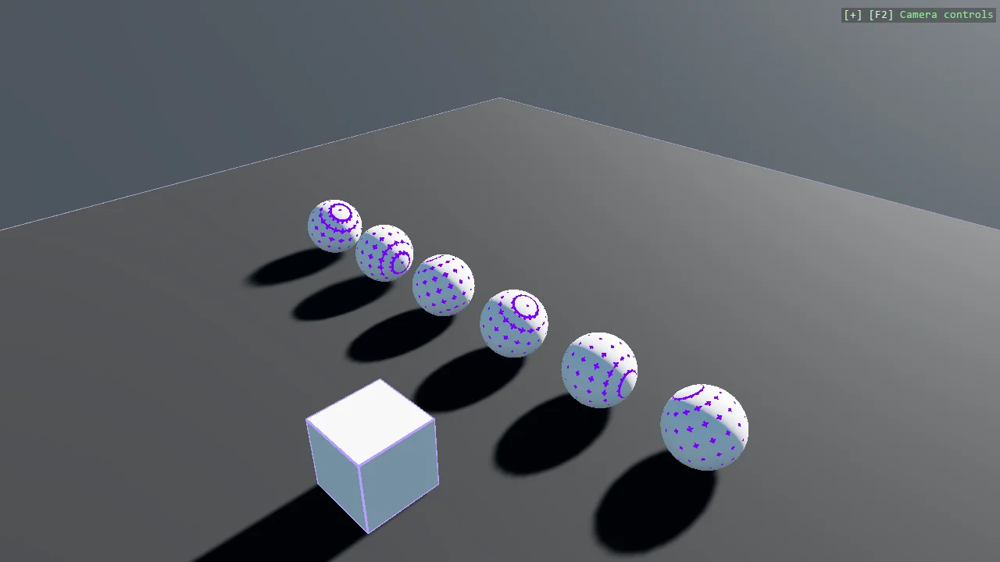

# Debug Render Component

The companion to the collidable gizmo: DebugRenderComponentScript draws the wireframe of every
entity's mesh rather than its collider, from one script on an empty entity. Having both on the same scene is how you tell the two apart -
when a body behaves oddly, the question is usually whether the mesh and the collider agree, and each
script answers one half of that.

The `Program.cs` file shows how to:

- Drawing every entity's mesh as a wireframe overlay, from one script on an empty entity
- How this differs from CollidableGizmoScript, which draws the collider
- Toggling the overlay with its Visible property
- Comparing mesh against collider when a body misbehaves
- The one-call form for a whole scene: game.AddPhysicsDebug()
- Using helpers: SceneSetup3D, UseSkybox, CreatePrimitive, AddGrabber

View on [GitHub](https://github.com/stride3d/stride-community-toolkit/tree/main/examples/code-only/E08_3D_DebugRenderComponent).

[!code-csharp]