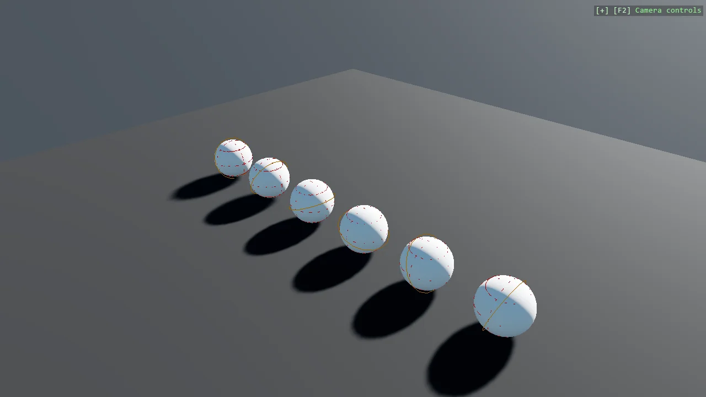

# Debug Shapes Usage

The short version of the debug shapes example: turn the system on, draw a sphere and a circle, done.
If the full tour is a reference, this is the copy-paste starting point - the minimum needed to get a
shape on screen while debugging something else.

The `Program.cs` file shows how to:

- Initialising the debug shape system and enabling it for a scene
- Drawing a sphere and a circle at given positions
- Requires the Stride.CommunityToolkit.DebugShapes package

View on [GitHub](https://github.com/stride3d/stride-community-toolkit/tree/main/examples/code-only/E08_3D_DebugShapes_QuickStart).

[!code-csharp]