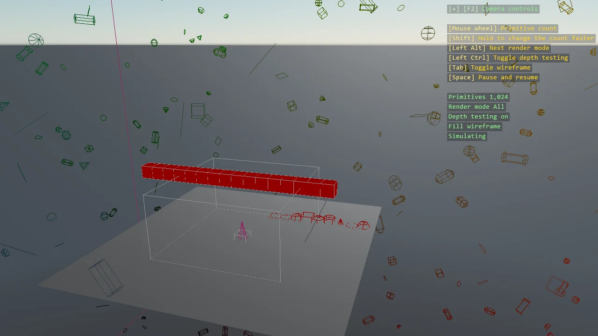

# Debug Shapes

The full tour of the DebugShapes package: every immediate-mode primitive it can draw, exercised from
a ShapeUpdater component so the shapes animate and the batching can be seen under load. Debug shapes
are drawn per frame and never become entities, which is what makes them cheap enough to leave in
while you work.

The `Program.cs` file shows how to:

- Registering the debug shape renderer
- Drawing every primitive the package offers
- Why immediate-mode shapes cost nothing to create and destroy
- Driving debug drawing from a component that updates each frame
- Requires the Stride.CommunityToolkit.DebugShapes package

View on [GitHub](https://github.com/stride3d/stride-community-toolkit/tree/main/examples/code-only/E08_3D_DebugShapes).

[!code-csharp]