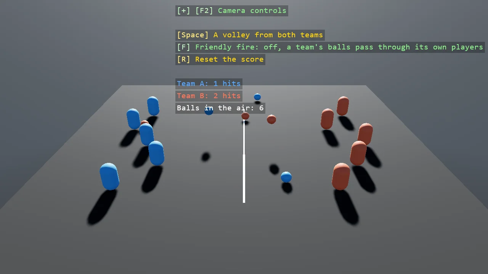

# Dodgeball

Dodgeball on four collision layers: each team's players and each team's balls have a layer of
their own, and the matrix says a team's balls pass through its own players and hit the other
team's. Each ball's contact handler scores the hit, so the rules and the score both come from
the layers and the contacts. The teams throw by themselves; F turns friendly fire on by pairing a
team's balls with its own players in the matrix.

The `Program.cs` file shows how to:

- Four layers and the matrix pairs that make the rules of a game
- A contact handler on a projectile that scores off the entity it touches
- Friendly fire as one matrix pair flipped at runtime
- One shared model for every ball and every player, through ShareModel
- Using helpers: SceneSetup3D, UseBepu, UseSkybox, CreatePrimitive, CreateMaterial, GetSimulation, ShapeBatch, TextOverlay

View on [GitHub](https://github.com/stride3d/stride-community-toolkit/tree/main/examples/code-only/E05_3D_Dodgeball).

[!code-csharp]