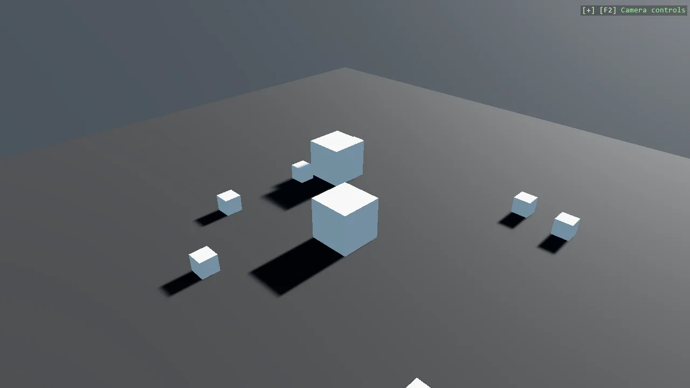

<!-- #region generated -->
# Give Me a Cube

Add behaviour to an entity with a SyncScript component instead of the update callback of game.Run.
The script steers a cube around a circle each frame by setting the linear velocity of a kinematic
Bepu body, so it really sweeps through the scene and knocks a ring of smaller dynamic cubes out of
the way. Writing Transform.Position instead would move only the mesh and collide with nothing.

The `Program.cs` file shows how to:

- Adding behaviour with a SyncScript component
- The Start and Update lifecycle methods
- Configuring a script through public properties
- Moving a kinematic body by setting its linear velocity
- Waking a body after changing its velocity
- Why writing Transform.Position does not move a physics body
- Sizing a primitive and its collider together
- Using helpers: SceneSetup3D, UseSkybox, CreatePrimitive

View on [GitHub](https://github.com/stride3d/stride-community-toolkit/tree/main/examples/code-only/E02_3D_GiveMeACube).

[!code-csharp]
<!-- #endregion generated -->

## OrbitScript.cs

[!code-csharp]