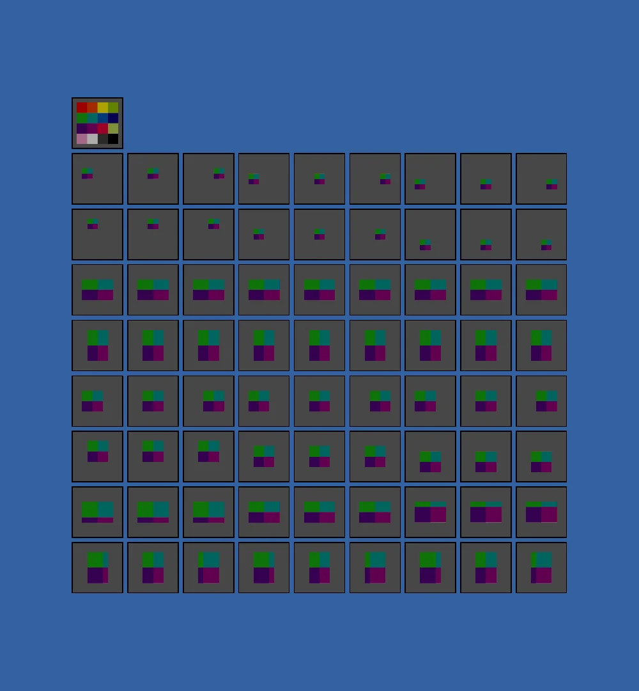

# Image Processing (TextureCanvas)

Every combination of anchor and stretch that TextureCanvas can apply, drawn as a grid of thumbnails
so the options can be compared rather than read about. Each cell blits a region of a source texture
into a destination rectangle with one setting changed, and renders the result into a UI card. The
canvases are disposed as they go - each one owns a GPU render target, and a grid of them left open
would be an easy leak.

The `Program.cs` file shows how to:

- Drawing into an offscreen target with CreateTextureCanvas
- Blitting a source rectangle into a destination rectangle
- How Anchor and Stretch interact when the aspect ratios differ
- Choosing a SamplingPattern for the resample
- Turning a canvas into a Texture for display
- Disposing each canvas so its render target is released
- Laying results out in a UniformGrid of UI cards

View on [GitHub](https://github.com/stride3d/stride-community-toolkit/tree/main/examples/code-only/E09_2D_ImageProcessing).

[!code-csharp]