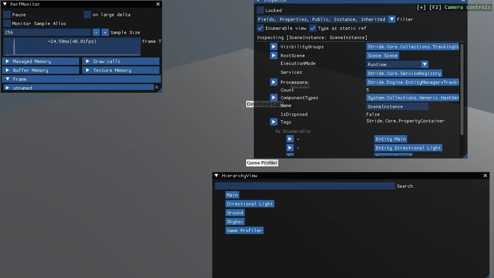

# ImGui UI

An ImGui overlay for in-game tools, debug panels and live tweaking. Immediate-mode UI suits this job
because there is no widget tree to keep in sync - you describe the panel every frame from whatever
the values happen to be. The example is short because the toolkit owns the setup: initialising the
integration, feeding it input and drawing it are already handled.

The `Program.cs` file shows how to:

- Initialising the ImGui integration
- Drawing windows, menus and controls every frame
- Why immediate mode removes the need to sync UI state
- Showing live stats in a debug panel

View on [GitHub](https://github.com/stride3d/stride-community-toolkit/tree/main/examples/code-only/E04_ImGui).

[!code-csharp]