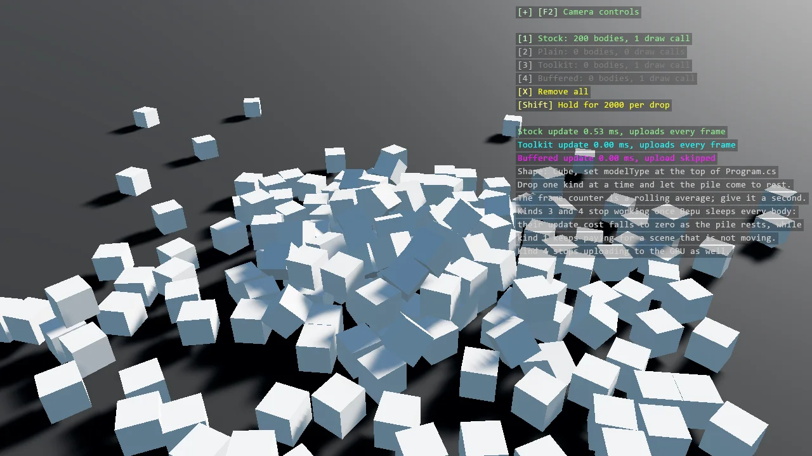

# Instancing with Entity Transforms

Every object stays a real entity, with a transform and a physics body, while the whole crowd is
drawn in one draw call: a master entity holds the ModelComponent and an instancing type that reads
its members' world matrices each frame. Bepu drives the transforms, so the bodies collide and pile
up as usual. Four kinds of body drop side by side: Stride's InstancingEntityTransform, no instancing,
the toolkit's BepuEntityInstancing and BufferedEntityInstancing. The toolkit types do no work once
Bepu puts the bodies to sleep, which takes a settled 20,000-cube pile from 239 to 329 FPS; instancing
removes draw calls and does nothing about simulation cost. One line switches the pile to another
primitive.

The `Program.cs` file shows how to:

- Combining physics bodies with instanced rendering
- Comparing four instancing strategies side by side at runtime
- The master and instance split for entity-driven instancing
- Why an instance entity must not have its own ModelComponent
- Skipping instancing work entirely while physics bodies sleep
- Owning GPU instance buffers to avoid redundant uploads
- Deriving a Bepu collider from a primitive type without building a mesh per body
- Switching the whole scene to a different primitive from one line
- Knowing when instancing does not help
- Using helpers: SceneSetup3D, CreatePrimitive, AddBepuPhysics, AddInstancingBufferUpload, TextOverlay

View on [GitHub](https://github.com/stride3d/stride-community-toolkit/tree/main/examples/code-only/E10_3D_Instancing_EntityTransform).

[!code-csharp]