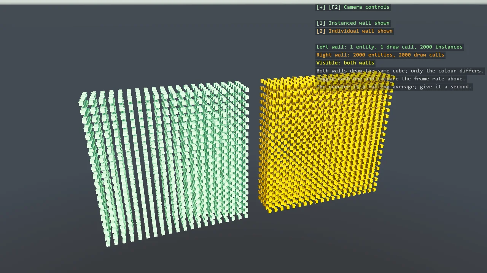

# GPU Instancing

Render two walls of the same cube built two different ways, side by side. The right wall uses one
entity per cube and costs one draw call each; the left wall uses a single entity with an
InstancingComponent and an array of world matrices, and costs one draw call in total. Each wall
shares one Model across its cubes, so the only rendering difference is instancing. Toggle each wall to compare the frame rate, and
note that the default compositor has no InstancingRenderFeature: the example adds it by hand, which UseInstancing on the setup or AddInstancingSupport otherwise does.

The `Program.cs` file shows how to:

- Reducing draw calls with an InstancingComponent
- Building an InstancingUserArray from world matrices
- Registering InstancingRenderFeature on the MeshRenderFeature
- Sharing one Model between many entities
- Toggling a ModelComponent to compare rendering cost
- Using helpers: SceneSetup3D, CreatePrimitive, CreateMaterial, TextOverlay

View on [GitHub](https://github.com/stride3d/stride-community-toolkit/tree/main/examples/code-only/E10_3D_Instancing).

[!code-csharp]