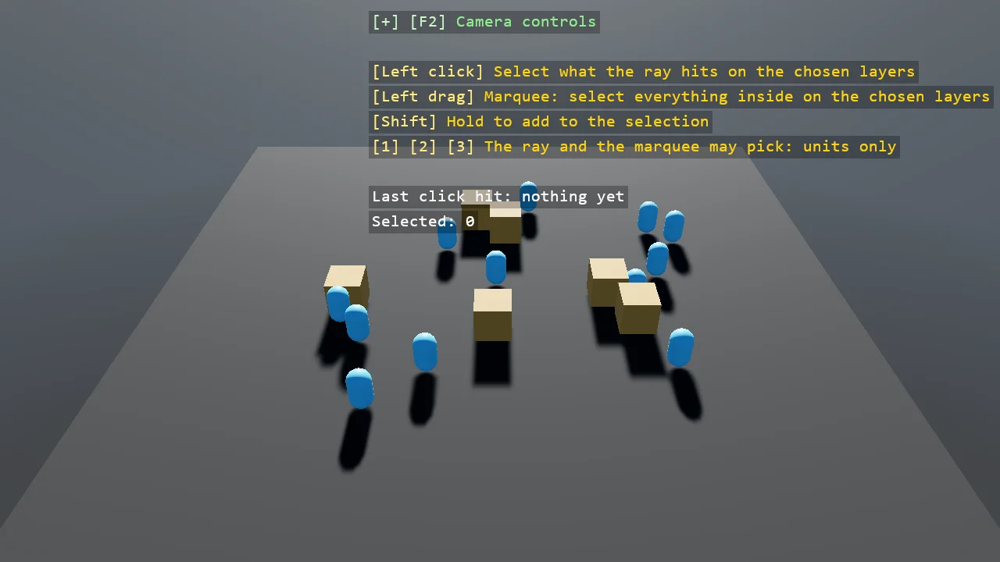

# Layer Selection

Selecting things through collision layers. A click is a raycast whose mask says which layers it
may hit, and the keys let it pick units alone, units and crates, or anything at all; a dragged
marquee tests every candidate on the chosen layers through the camera's IsInScreenRectangle.
Rings mark the selection, Shift adds to it and a click on nothing clears it.

The `Program.cs` file shows how to:

- A raycast's CollisionMask as the filter for what a click can select
- Marquee selection with IsInScreenRectangle over the candidates on the chosen layers
- A click and a drag told apart by the distance the mouse moved
- A screen-space rectangle drawn through a ShapeBatch after the post effects
- Using helpers: SceneSetup3D, UseBepu, UseSkybox, CreatePrimitive, CreateMaterial, GetSimulation, ScreenToWorldRay, IsInScreenRectangle, ShapeBatch, TextOverlay

View on [GitHub](https://github.com/stride3d/stride-community-toolkit/tree/main/examples/code-only/E05_3D_LayerSelection).

[!code-csharp]