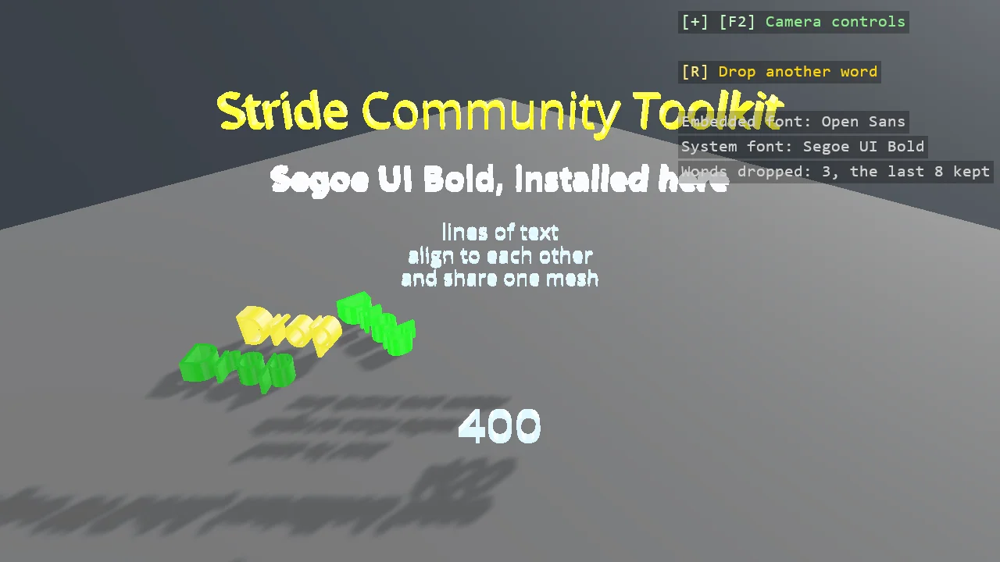

# 3D Text from a Font

Solid 3D text from a real font: TextMesh reads a font's glyph outlines through the FreeType the
engine ships, triangulates them, holes and all, and extrudes them into meshes that are lit and
shadowed like any other geometry. On show: the Open Sans embedded in the toolkit with a bevelled edge, an installed
font found by family name, several lines that align in one mesh, a frame counter whose digits
are rebuilt as a new mesh every frame, and words with physics through Primitive3D.Text, dropped
on the ground with one convex hull per glyph. The counter demonstrates the one rule of dynamic
mesh text: dispose the old GPU buffers before swapping in the new mesh, or leak a buffer pair per
rebuild.

The `Program.cs` file shows how to:

- Solid 3D lettering from any font: TextMesh.CreateModel with MeshFont.Default, Load or FromFamily
- TextMeshOptions - size per EM, depth, bevel, anchor, alignment, line spacing, curve quality
- Words as primitives with bodies - Primitive3D.Text through CreatePrimitive, one convex hull per glyph
- Static lettering built once versus text that changes, and releasing the old buffers
- Using helpers: SceneSetup3D, AddAllDirectionLighting, CreatePrimitive, DebugOverlay

View on [GitHub](https://github.com/stride3d/stride-community-toolkit/tree/main/examples/code-only/E03_3D_MeshText).

[!code-csharp]