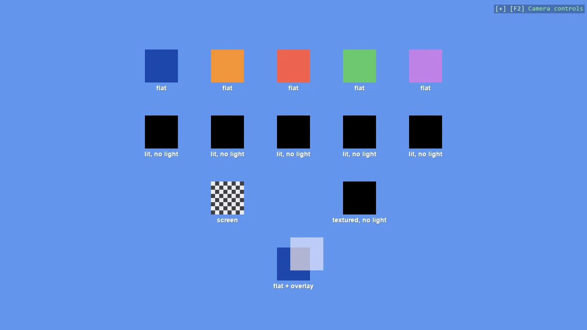

# 2D Material

What each material helper does on a flat shape, in four rows of squares: the flat material a 2D
scene wants, the same colours as a lit material, black because nothing in a 2D scene lights them,
a checkerboard built in code as a screen material and as a lit textured one, and a translucent
overlay drawn over a square.

The `Program.cs` file shows how to:

- CreateFlatMaterial, the colour as given, which is what a 2D scene wants
- Why a lit CreateMaterial is black in a scene with no light
- A texture built in code with TextureLoader.FromPixels
- CreateScreenMaterial, the unlit texture, against the lit CreateTexturedMaterial
- CreateOverlayMaterial for a translucent shape drawn over another
- Labelling entities with EntityTextComponent
- Using helpers: SceneSetup2D, AddEntityTextRenderer, CreatePrimitive

View on [GitHub](https://github.com/stride3d/stride-community-toolkit/tree/main/examples/code-only/E02_2D_Material).

[!code-csharp]