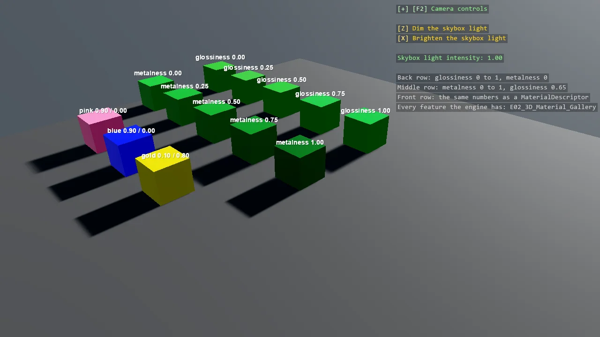

# 3D Material

The four numbers of a material, one per row of cubes: a glossiness sweep from rough to mirror, a
metalness sweep from dielectric to metal, and a front row that builds the same numbers as a
MaterialDescriptor feature by feature - which is what CreateMaterial does. Each cube carries its
number. Z and X change the skybox light while it runs, because a metal is almost entirely a
reflection of its environment and goes dark without one.

The `Program.cs` file shows how to:

- Creating a material from a colour, a glossiness and a metalness with CreateMaterial
- What glossiness changes on screen, from rough to mirror
- What metalness changes on screen, and why a metal has no diffuse colour
- Building the same material from MaterialDescriptor feature by feature
- Why the microfacet model's environment term matters in a code-only game
- Labelling entities with screen-space EntityTextComponent
- Adjusting the skybox light at runtime from keyboard input
- Using helpers: SceneSetup3D, AddSkybox, AddEntityTextRenderer, CreatePrimitive, CreateMaterial

View on [GitHub](https://github.com/stride3d/stride-community-toolkit/tree/main/examples/code-only/E02_3D_Material).

[!code-csharp]