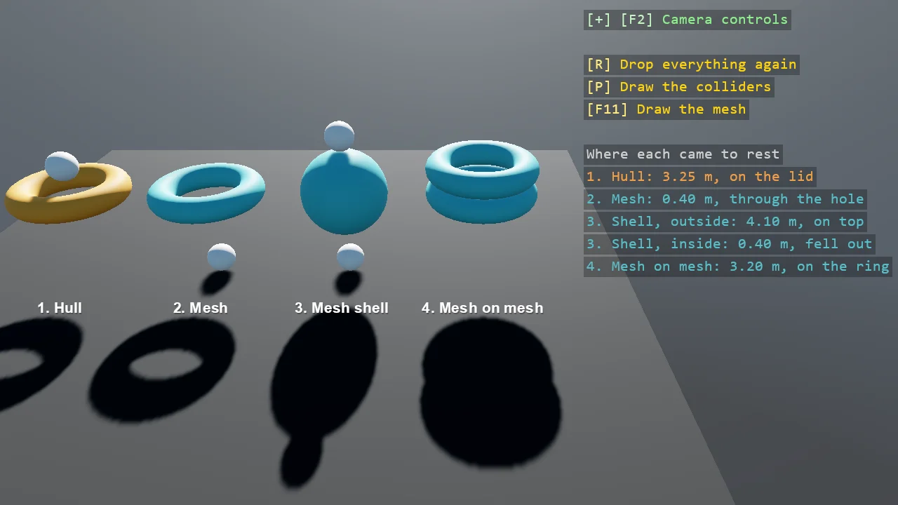

# Mesh Colliders

A collider made from real geometry, two ways: a convex hull wraps the model in the smallest convex
shape that holds it, so a ring becomes a disc, and a mesh collider is the model's own triangles,
so the hole stays a hole. A ball rests on the hull's invisible lid and falls through the mesh's
hole; a mesh sphere shows that a mesh is a surface with no inside; a moving mesh ring lands on a
mesh ring. The overlay prints where each dropped thing came to rest, and P draws the colliders.

The `Program.cs` file shows how to:

- ConvexHullCollider from a model through TorusCollider, and what a hull does to a hole
- MeshCollider from a model, attached once the model exists, Closed for the inertia
- A mesh is a surface with no inside, so a body that starts inside is not pushed out
- Meshes meet meshes, triangle against triangle, which is why what moves is better off convex
- Reading where a body came to rest from its position and velocity, with Teleport for the replay
- Using helpers: SceneSetup3D, CreatePrimitive, TorusCollider, AddPhysicsDebug, TextOverlay

View on [GitHub](https://github.com/stride3d/stride-community-toolkit/tree/main/examples/code-only/E05_3D_MeshColliders).

[!code-csharp]