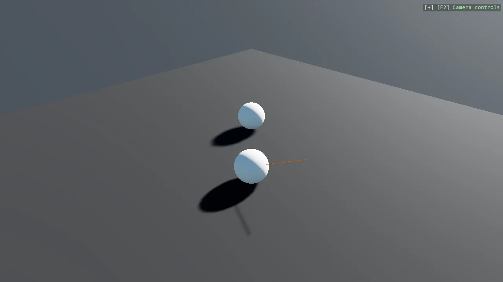

# Mesh Line

A line attached to a sphere, built as a real mesh rather than a debug primitive. Two vertices,
an index buffer, a MeshDraw set to LineList and an emissive material are all it takes, which makes
this the smallest useful tour of Stride's low-level geometry API. The line is parented to one of the
spheres, so moving that sphere moves the line with it.

The `Program.cs` file shows how to:

- Building a mesh from raw vertex and index buffers
- Declaring a vertex layout with VertexDeclaration
- Drawing with PrimitiveType.LineList instead of triangles
- Wrapping a MeshDraw in a Mesh, Model and ModelComponent
- Making a line visible with an emissive material
- Parenting an entity so it follows another
- Using helpers: SceneSetup3D, UseSkybox, CreatePrimitive, GizmoEmissiveColorMaterial.Create

View on [GitHub](https://github.com/stride3d/stride-community-toolkit/tree/main/examples/code-only/E07_3D_MeshLine).

[!code-csharp]