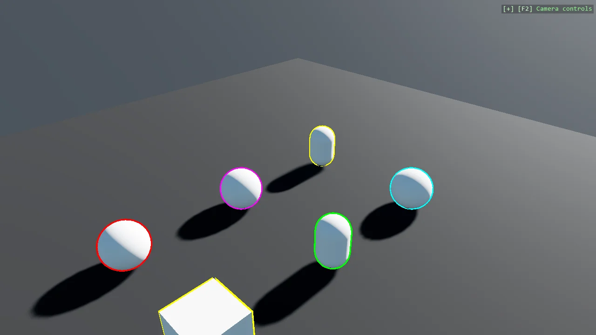

# Mesh Outline Render Feature

Draw coloured outlines around 3D primitives with a custom RootRenderFeature. Each mesh is drawn a
second time, inflated along its normals with front faces culled, so only a shell remains visible
behind the original mesh. Adding a MeshOutlineComponent to an entity is all it takes to outline it,
and a high intensity pushes the outline into HDR range so bloom makes it glow.

The `Program.cs` file shows how to:

- Writing a custom RootRenderFeature
- Registering a render feature with AddRootRenderFeature
- Driving rendering from a custom EntityComponent
- Building a MutablePipelineState and applying a DynamicEffectInstance
- Inflating a mesh along its normals in a shader
- Skipping render stages that bind no render target
- Using helpers: SceneSetup3D, UseSkybox

View on [GitHub](https://github.com/stride3d/stride-community-toolkit/tree/main/examples/code-only/E09_3D_MeshOutline).

[!code-csharp]