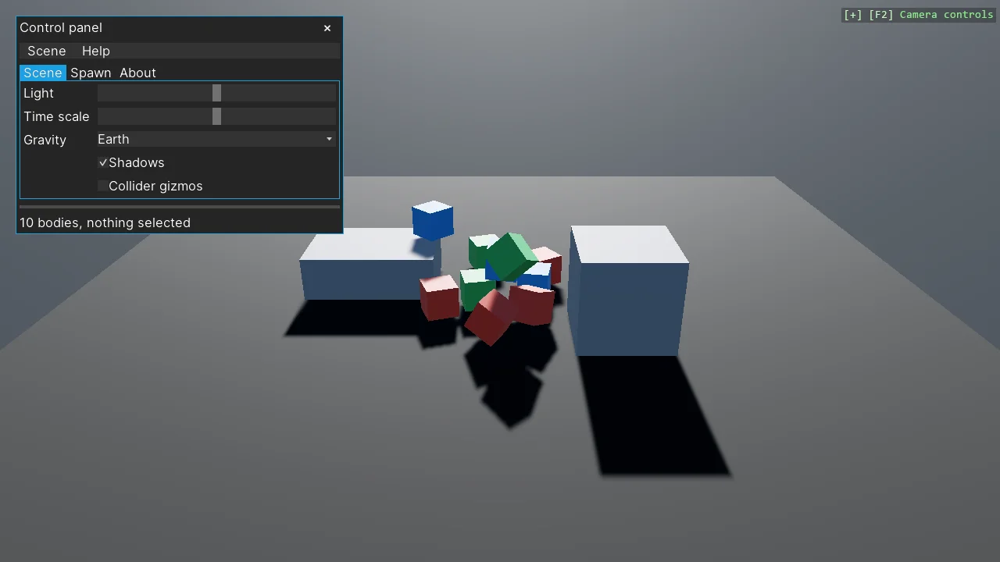

# Myra UI - Control Panel

Myra's widget set at work in one draggable window that drives a Stride scene: a menu bar, tabs, a
grid of sliders for the light and the physics clock, a combo for gravity, check buttons for shadows
and collider gizmos, a spin button and buttons that spawn bodies, a list view that selects and
lights one, a dialog that asks before clearing, tooltips and a status line. The UI reaches the
scene through plain C# on the same objects; the renderer that hosts Myra is the one from the
draggable window example.

The `Program.cs` file shows how to:

- Hosting Myra through a scene renderer that builds the widgets once the device exists
- Window, HorizontalMenu, TabControl, Grid with proportions, VerticalStackPanel and HorizontalStackPanel
- HorizontalSlider, CheckButton, ComboView, SpinButton, Button, ListView, Dialog, tooltips, a progress bar
- Widget handlers set flags or values; the scene reacts in Update, on the game thread
- Driving a LightComponent, the simulation's TimeScale and PoseGravity, and the collider gizmos from UI
- Using helpers: SceneSetup3D, CreatePrimitive, AddSceneRenderer, AddPhysicsDebug, CreateMaterial

View on [GitHub](https://github.com/stride3d/stride-community-toolkit/tree/main/examples/code-only/E04_Myra_ControlPanel).

[!code-csharp]