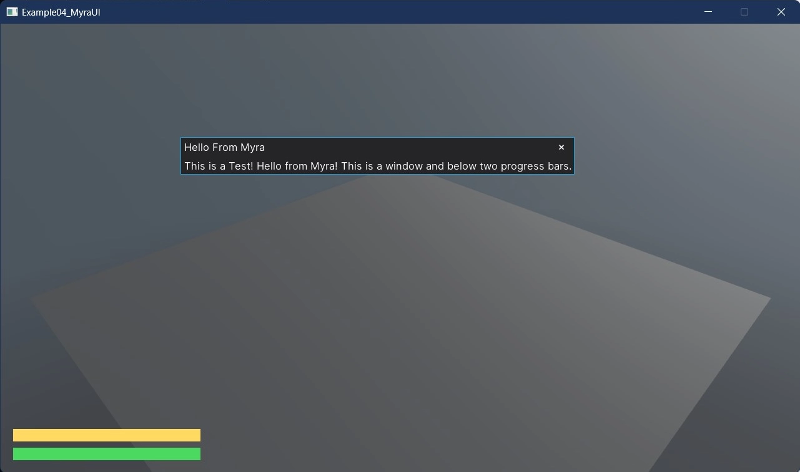

<!-- #region generated -->
# Myra UI - Draggable Window and Services

Myra, an external UI library, hosted inside Stride: a draggable window, two health bars - one
declared in the view, one added while it runs - and service lookup through GetService to keep the UI
from depending directly on the game. Hosting a foreign UI toolkit means giving it a scene renderer
of its own and a place in the compositor, which is what MyraSceneRenderer does.

The `Program.cs` file shows how to:

- Hosting an external UI library inside Stride
- Rendering a foreign UI through a custom scene renderer
- Building a draggable window from Myra widgets
- Adding widgets statically and at runtime
- Decoupling UI from the game with GetService()

View on [GitHub](https://github.com/stride3d/stride-community-toolkit/tree/main/examples/code-only/E04_Myra_DraggableWindow).

[!code-csharp]
<!-- #endregion generated -->

## MyraSceneRenderer.cs

The scene renderer that draws the Myra desktop over the scene.

[!code-csharp]

## MainView.cs

The main window and its health bar, a `HorizontalProgressBar`.

[!code-csharp]

## UIUtils.cs

Helpers that build the widgets used in more than one place.

[!code-csharp]

## See also

- [Using Myra in Stride Engine Tutorial](https://github.com/rds1983/Myra/wiki/Using-Myra-in-Stride-Engine-Tutorial)