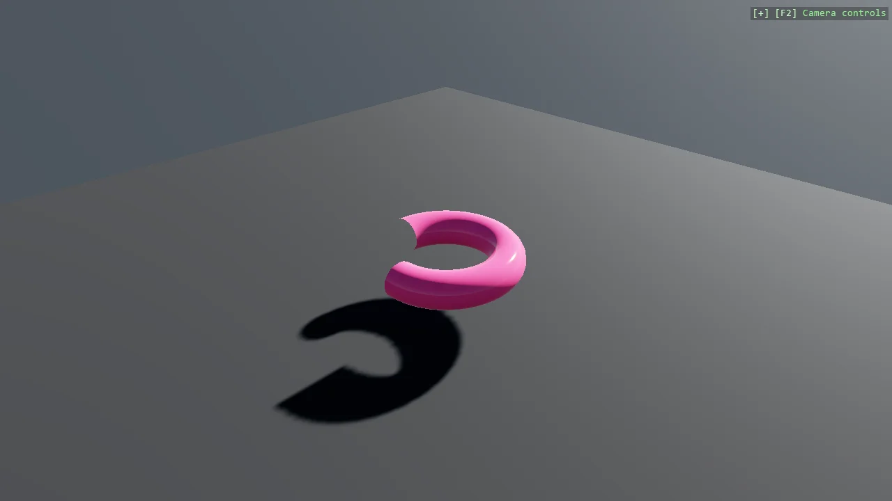

# Partial Torus Mesh in F#

The parametric partial torus, written in F#. The geometry is identical to the C# version; what
differs is the shape of the code - the vertex generation is nested for loops with
their results piped to ignore, and mutable engine state has to be assigned with the left arrow rather than plain equals.

The `Program.fs` file shows how to:

- Generating parametric geometry in F#
- Expressing vertex generation with nested for loops
- Assigning to engine properties with the <- operator
- Computing correct normals for smooth shading
- Interoperating with the C# MeshBuilder API from F#
- Using helpers: SceneSetup3D, UseBepu, UseSkybox

View on [GitHub](https://github.com/stride3d/stride-community-toolkit/tree/main/examples/code-only/E07_3D_PartialTorus_FSharp).

[!code-fsharp]