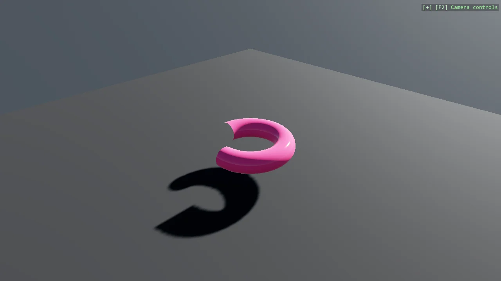

# Partial Torus Mesh

A torus defined parametrically from two angles - one around the tube, one around the ring - and cut
short by limiting the second, which turns the same code into an arc, a horseshoe or a full ring
without special cases. Normals are computed rather than guessed, because a parametric surface lit
with wrong normals looks subtly faceted in a way that is hard to trace back.

The `Program.cs` file shows how to:

- Defining a surface from two angle parameters
- Making the shape partial by constraining the bend angle
- Computing correct normals for smooth shading
- Reusing vertices between adjacent triangles through indexing
- Getting triangle winding right so faces are not culled
- Using helpers: SceneSetup3D, UseSkybox

View on [GitHub](https://github.com/stride3d/stride-community-toolkit/tree/main/examples/code-only/E07_3D_PartialTorus).

[!code-csharp]