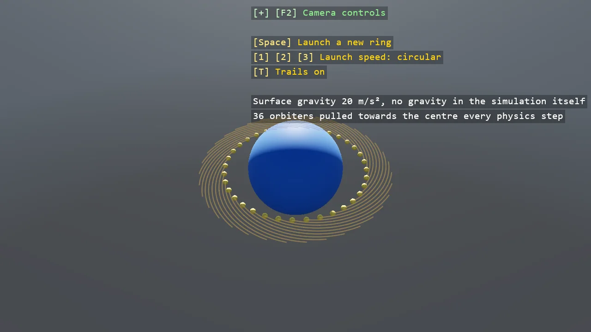

# Planet Gravity

A ring of bodies orbiting a planet. The simulation's own gravity is zero, set through the setup's
GameSettings, and a script that runs on every physics step pulls each body towards the planet's
centre, falling off with the square of the distance. Three launch speeds give a circle, a spiral
in and an ellipse, and trails show the paths; a frame runs zero or several physics steps, so a
force per step lives in SimulationUpdate, not in Update.

The `Program.cs` file shows how to:

- PoseGravity set to zero for a simulation through the setup's GameSettings
- A per-step pull applied in ISimulationUpdate as a velocity change on each body
- The circular orbit speed from the gravitational parameter and the radius
- One shared model for every orbiter, through ShareModel
- Using helpers: SceneSetup3D, UseBepu, UseSkybox, CreatePrimitive, CreateMaterial, ShapeBatch, TextOverlay

View on [GitHub](https://github.com/stride3d/stride-community-toolkit/tree/main/examples/code-only/E05_3D_PlanetGravity).

[!code-csharp]