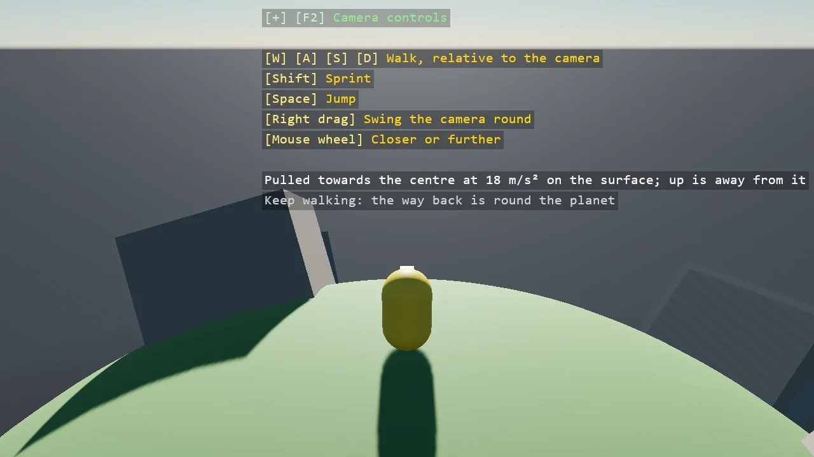

# Planet Walker

A character walking round a planet with the follow camera behind it. The simulation's gravity is
off and a script pulls the character towards the centre every physics step; the character's
Orientation and the camera's Up are set to the direction away from the centre each frame, so the
ground test, the jump, the move vector and the camera's orbit all follow the surface. Walk far
enough and you come back round.

The `Program.cs` file shows how to:

- A per-step pull towards a point in place of the simulation's gravity
- CharacterComponent.Orientation set every frame, so its LocalUp and move vector follow a curved surface
- The follow controller's Up, with Forward and Right read back for walking
- Static blocks placed and turned to stand on a sphere
- Using helpers: SceneSetup3D, UseBepu, UseSkybox, CreatePrimitive, CreateMaterial, Basic3DFollowCameraController, RayCast, TextOverlay

View on [GitHub](https://github.com/stride3d/stride-community-toolkit/tree/main/examples/code-only/E05_3D_PlanetWalker).

[!code-csharp]