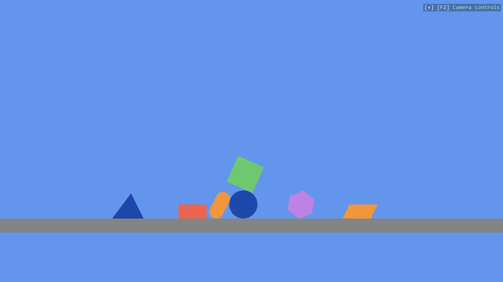

# 2D Primitives

Create a minimal 2D scene using toolkit helpers and place multiple different primitive shapes.
Demonstrates entity creation, basic positioning, and attaching the entities to the scene.

The `Program.cs` file shows how to:

- Creating multiple 2D primitives (Circle, Capsule, Rectangle, Square, RegularPolygon, Triangle, Polygon)
- Positioning entities with Transform.Position
- Adding entities to a Scene (rootScene)
- Using helpers: SceneSetup2D, AddGrabber

View on [GitHub](https://github.com/stride3d/stride-community-toolkit/tree/main/examples/code-only/E02_2D_Primitives).

[!code-csharp]