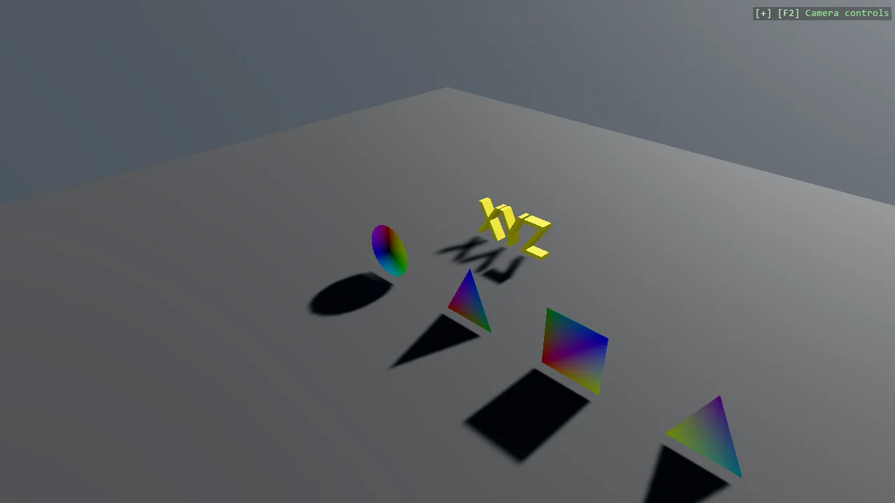

# Procedural Geometry

A triangle, a plane and a circle built at runtime with MeshBuilder, which handles the vertex layout
and buffer bookkeeping that raw buffers make you do by hand. The circle is rebuilt every frame with
a changing segment count, which is where the one rule of dynamic geometry shows up: dispose the old
buffers before swapping in the new mesh, or leak a buffer pair per frame.

The `Program.cs` file shows how to:

- Declaring a vertex layout and filling it with MeshBuilder
- Building a triangle, a plane and a circle from first principles
- Rebuilding a mesh every frame as a parameter changes
- Disposing the previous mesh's buffers before replacing it, and sharing one material
- Why clockwise winding matters for which face you see
- Creating a non-indexed mesh when index reuse buys nothing
- Using helpers: SceneSetup3D, UseSkybox, CreateMaterial

View on [GitHub](https://github.com/stride3d/stride-community-toolkit/tree/main/examples/code-only/E07_3D_ProceduralGeometry).

[!code-csharp]