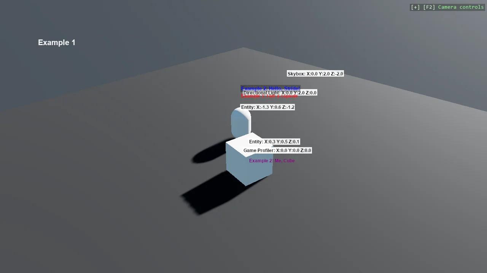

# Custom Scene Renderers

Three ways to draw 2D content over a 3D scene, side by side. A SceneRendererBase subclass
covers the whole scene and is the right shape for HUDs and text overlays; a DelegateSceneRenderer
created from a StartupScript belongs to one entity and is the right shape for labels attached to a
thing; the toolkit's EntityTextComponent does the same with no renderer of your own. The first
two project world positions into screen space and draw through a SpriteBatch, so the example
also covers where those resources are created and when they must be released.

The `Program.cs` file shows how to:

- Hooking the pipeline by subclassing SceneRendererBase
- Attaching a renderer to one entity with DelegateSceneRenderer
- Converting a world position into screen coordinates
- Drawing text and backgrounds with SpriteBatch
- Deciding between a scene-wide and an entity-scoped renderer
- Labelling entities with the toolkit's EntityTextComponent and EntityTextRenderer
- Initialising and releasing renderer resources at the right time
- Using helpers: SceneSetup3D, UseSkybox, CreatePrimitive

View on [GitHub](https://github.com/stride3d/stride-community-toolkit/tree/main/examples/code-only/E09_3D_SceneRenderer).

[!code-csharp]