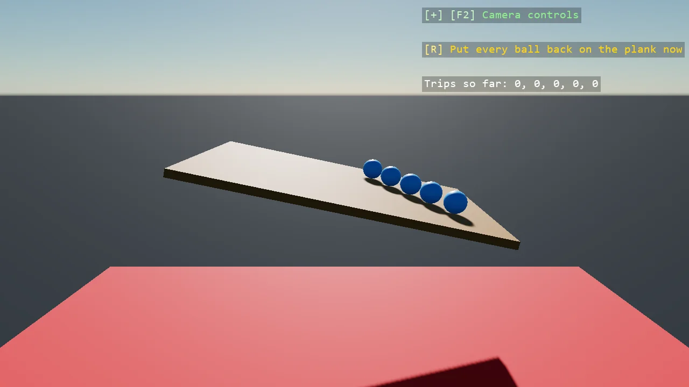

# Reset Out of Bounds

A row of balls drops onto a tilted plank with no ground under it, rolls off its low end and falls. The
update reads every ball's position once a frame, and a ball below the red line goes back above the high
end of the plank with TeleportAtRest, still and awake, so it rolls again; the overlay counts the trips.
Teleport alone would keep the speed and the spin the ball arrived with.

The `Program.cs` file shows how to:

- A threshold under the scene, read from each body's entity position once a frame
- TeleportAtRest puts a body back still and awake, where Teleport alone keeps its speed and spin
- A static body tilted through its transform before it joins the scene
- A model with no body as a marker, with Body = BodyMode.None
- Using helpers: SceneSetup3D, UseBepu, UseSkybox, CreatePrimitive, CreateMaterial, TeleportAtRest, TextOverlay

View on [GitHub](https://github.com/stride3d/stride-community-toolkit/tree/main/examples/code-only/E05_3D_ResetOutOfBounds).

[!code-csharp]