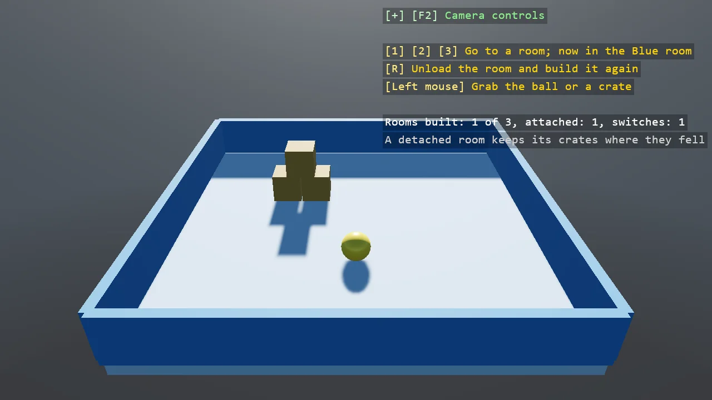

# Scene Switching

Rooms as child scenes: three rooms built in code, each a scene attached to the root by adding it
to Children and detached by removing it, one at a time. A room change moves the player entity
into the new room's scene under a screen fade, so the swap is never seen half done; a detached
room keeps its crates where they fell, and R throws the room away and builds it again, the
unload-and-load case.

The `Program.cs` file shows how to:

- Child scenes attached and detached through Scene.Children
- An entity moved between scenes by setting its Scene
- A detached scene keeping its state, against a rebuilt one
- A scene change run between the halves of a ScreenFade transition or wipe
- Using helpers: SceneSetup3D, UseBepu, UseSkybox, CreatePrimitive, CreateMaterial, AddScreenFade, AddGrabber, TextOverlay

View on [GitHub](https://github.com/stride3d/stride-community-toolkit/tree/main/examples/code-only/E02_3D_SceneSwitching).

[!code-csharp]