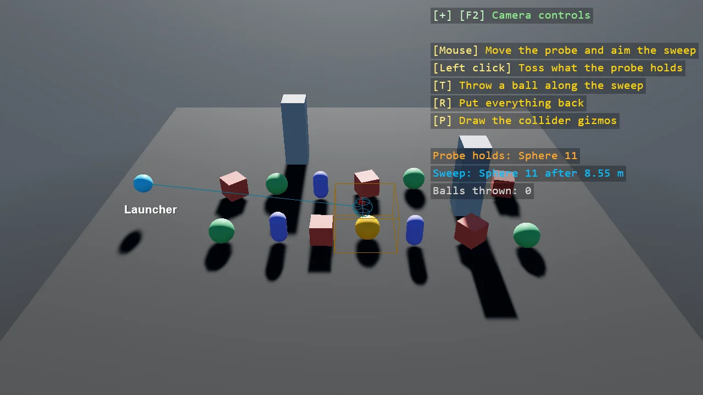

# Shape Queries

Two questions a raycast cannot answer: what is inside this volume right now, and what would this
shape touch first if it moved that way. A probe box follows the mouse over a field of bodies and
lists what it holds through Overlap; a click tosses them to prove the list. A ball is swept from a
launcher towards the mouse through SweepCast, a ghost marks where it would first touch, and T throws
a real ball along the same line, without gravity, to land where the ghost was.

The `Program.cs` file shows how to:

- Overlap with a convex shape at a pose, into a stack buffer that allocates nothing per frame
- SweepCast of a shape along a direction, and the hit's point, normal and distance along the path
- A unit direction makes the sweep's reach and distance metres; a real velocity makes them seconds
- A sweep is a straight line, so the thrown ball has gravity switched off per body
- Turning the mouse into a point on the ground with the camera's pick ray and a plane
- Highlighting a body with a material override, and removing it to restore the model's own
- Using helpers: SceneSetup3D, CreatePrimitive, AddDebugShapes, AddPhysicsDebug, DebugOverlay

View on [GitHub](https://github.com/stride3d/stride-community-toolkit/tree/main/examples/code-only/E05_3D_ShapeQueries).

[!code-csharp]