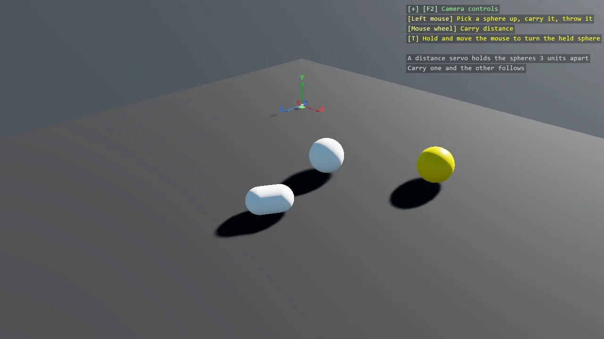

# Simple Constraint

One constraint, doing one thing: a distance servo holding two spheres three units apart, pulling
them together or pushing them apart until they settle there. It is the gentlest possible
introduction to Bepu constraints, and the shortest - everything else in the constraint family builds
on the same pattern of naming two bodies and describing the relationship you want between them.

The `Program.cs` file shows how to:

- Connecting two bodies with DistanceServoConstraintComponent
- Setting a target distance and watching the solver reach it
- How a constraint component attaches to an entity
- Reading the result against a ground reference grid
- Picking a sphere up with GrabberScript and feeling the servo pull the other along
- Using helpers: SceneSetup3D, UseSkybox, AddGroundGizmo

View on [GitHub](https://github.com/stride3d/stride-community-toolkit/tree/main/examples/code-only/E05_3D_Constraints_Simple).

[!code-csharp]