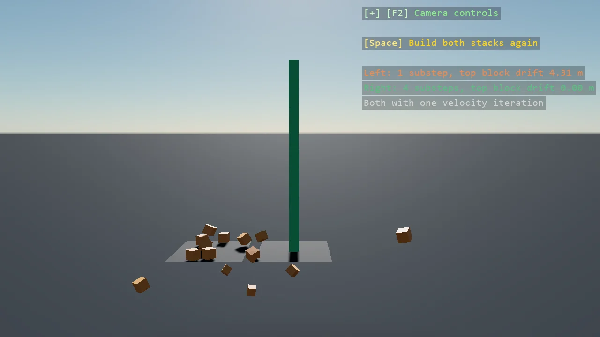

# Solver Substeps

Why a tall stack wobbles and what firms it up. Two simulations run the same stack of twenty
blocks, one with a single solver substep and one with four, both with one velocity iteration so
the substeps are the only difference;
the overlay reads how far each top block has drifted from the stack's axis. Substepping cuts
each step into pieces solved in turn, which steadies a chain of contacts far more than extra
iterations of one step. The count is fixed for a simulation's life, so it is set in the setup's
GameSettings.

The `Program.cs` file shows how to:

- SolverSubStep and SolverIteration on a BepuSimulation, set through the setup's GameSettings for the simulation's life
- A tall stack as a chain of contacts whose solver error climbs
- Two simulations side by side to compare one setting
- One shared model for every block, through ShareModel
- Using helpers: SceneSetup3D, UseBepu, UseSkybox, Add3DGround, CreatePrimitive, CreateMaterial, TextOverlay

View on [GitHub](https://github.com/stride3d/stride-community-toolkit/tree/main/examples/code-only/E05_3D_SolverSubsteps).

[!code-csharp]