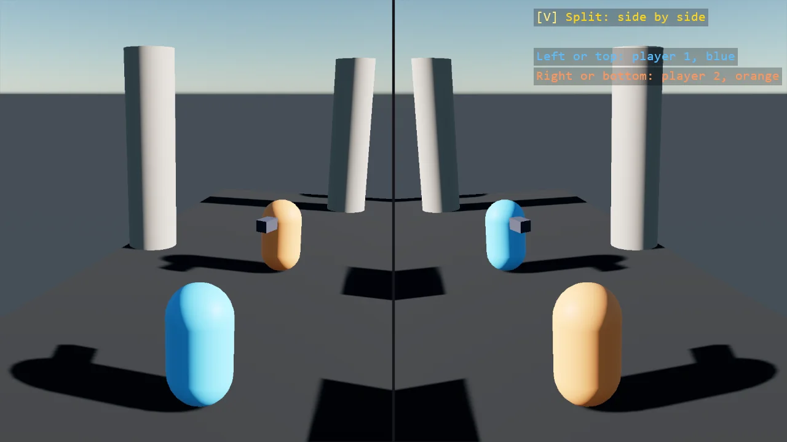

# Split Screen

Two players in one window. Each has a camera that draws into a texture through
AddRenderTextureCamera, and the window shows the two textures side by side as screen-space
rectangles, one ShapeBatch filled with each; V turns the split from side by side to top and
bottom. The halves are drawn after the post effects, where the feeds do not see them, and each
feed tone-maps itself.

The `Program.cs` file shows how to:

- One render-texture camera per player, placed behind it every frame
- A screen-space rectangle filled with a feed's texture, one ShapeBatch per feed, with the camera's aspect following the rectangle
- The split as geometry, side by side or top and bottom by a key
- Halves drawn after the post effects, out of the feeds' sight, with a tone map on each feed
- Using helpers: SceneSetup3D, UseBepu, UseSkybox, CreatePrimitive, CreateMaterial, AddRenderTextureCamera, FillWith, FaceDirection, LookAt, TextOverlay

View on [GitHub](https://github.com/stride3d/stride-community-toolkit/tree/main/examples/code-only/E09_3D_SplitScreen).

[!code-csharp]