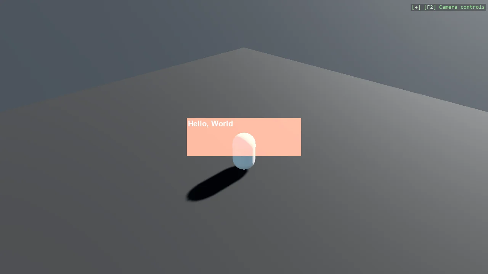

# Stride UI - Capsule and Window

A capsule in a 3D scene with a "Hello, World" panel drawn over it using Stride's built-in UI. The
interesting part is the assembly order, which the example splits into one small method per step:
load a font, build a TextBlock, put it on a Canvas, wrap the canvas in a UIComponent, and attach
that to an entity. A UI in Stride is an entity like any other, and it will not render without a font
loaded first.

The `Program.cs` file shows how to:

- Building a UI hierarchy from code with Canvas and TextBlock
- Loading a SpriteFont before any text can be drawn
- Hosting a UI on an entity through UIComponent
- Keeping scene setup readable by splitting it per element
- Using helpers: SceneSetup3D, UseSkybox, CreatePrimitive

View on [GitHub](https://github.com/stride3d/stride-community-toolkit/tree/main/examples/code-only/E04_StrideUI_BasicWindow).

[!code-csharp]