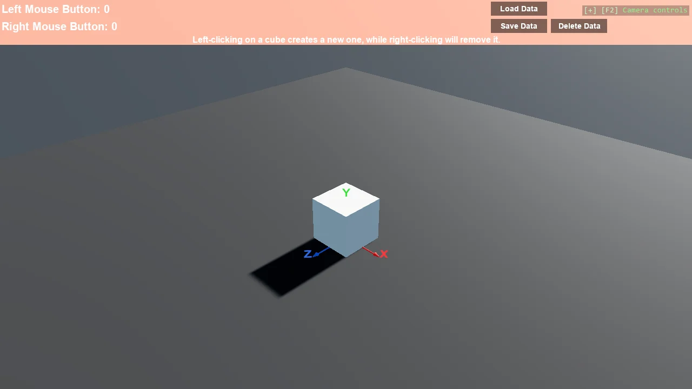

# Cube Clicker

A small clicker game: cubes appear, left and right clicks are counted, and both the score and the
cube positions are written to disk so the next run picks up where the last one stopped. It is the
largest UI example in the toolkit and the only one that persists state, split across several files
by responsibility rather than kept in one Program.cs.

The `Program.cs` file shows how to:

- Building an interactive UI from Grid, TextBlock and Button
- Saving and loading game state with the NexVYaml serializer
- Running game logic and short animations in AsyncScript
- Separating UI, state and game logic into their own files
- Restoring a scene from persisted data on startup

View on [GitHub](https://github.com/stride3d/stride-community-toolkit/tree/main/examples/code-only/E04_CubeClicker).

[!code-csharp]