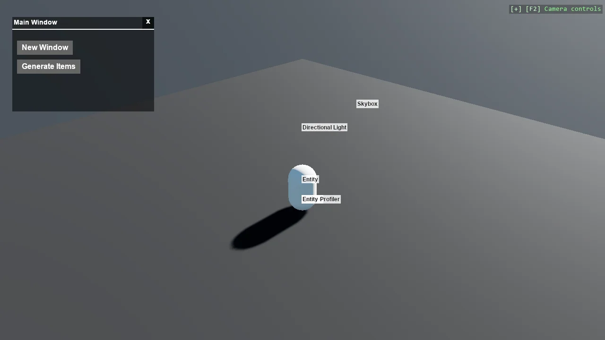

<!-- #region generated -->
# Stride UI - Draggable Window

A windowing system built on Stride's UI: windows with title bars and close buttons that can be
dragged around, and that come to the front when clicked. Z-order is the part that makes it feel
real, and it needs a container tracking every window rather than logic on each one. The windows spawn
falling spheres and keep a live count, with objects that drop out of the world cleaned up and
subtracted again.

The `Program.cs` file shows how to:

- Building a draggable window from Canvas and pointer events
- Bringing a window to the front by managing z-order centrally
- Splitting responsibility: container, window, manager, generator
- Spawning scene objects from a UI button
- Keeping a UI counter in step with the scene
- Removing entities that fall out of the world
- Using helpers: SceneSetup3D, UseSkybox, CreatePrimitive

View on [GitHub](https://github.com/stride3d/stride-community-toolkit/tree/main/examples/code-only/E04_StrideUI_DragAndDrop).

[!code-csharp]
<!-- #endregion generated -->

## Files

- `UIManager` - creates and manages the windows and updates their text
- `DragAndDropContainer` - the root canvas that tracks the draggable elements and their stacking order
- `DragAndDropCanvas` - one window: title bar, divider, close button and dragging
- `PrimitiveGenerator` - creates the spheres spawned from the UI and keeps their count, which the update loop in `Program.cs` lowers as it removes those that fall out of the world