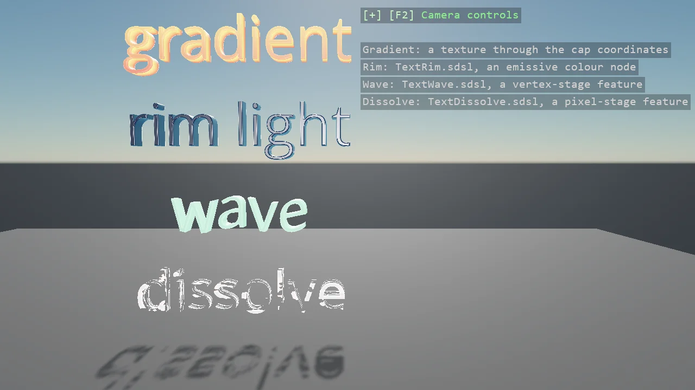

# 3D Text Shaders

Four materials on the same solid lettering, which is geometry like any other with normals and
texture coordinates: a gradient texture read through the caps' coordinates, a rim light from a
shader class of twenty lines as an emissive node, a wave that moves the vertices along the word on
the engine's clock through a feature in the vertex stage, and a dissolve with a glowing edge
through a feature in the pixel stage, its amount driven every frame. Each shader is in the
example's Effects folder and compiled at build like any other.

The `Program.cs` file shows how to:

- A text mesh's texture coordinates - caps across the block, walls along the outline and through the depth
- A texture node in the diffuse slot - ComputeTextureColor with clamped addressing
- A shader class as a colour node - ComputeShaderClassColor with MixinReference, keys set on the pass
- A material feature in the vertex stage - IMaterialDisplacementFeature and SetStreamFinalModifier, Global.Time
- A material feature in the pixel stage - IMaterialTransparencyFeature with a discard, driven per frame
- Using helpers: SceneSetup3D, AddAllDirectionLighting, TextMesh, TextBevel, TextOverlay

View on [GitHub](https://github.com/stride3d/stride-community-toolkit/tree/main/examples/code-only/E03_3D_TextShaders).

[!code-csharp]