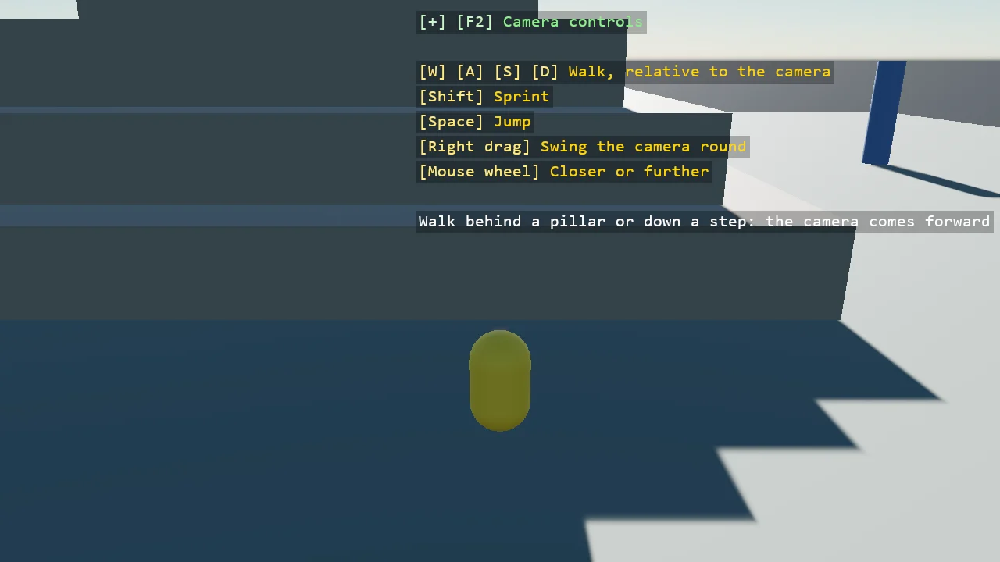

# Third-Person Camera

A character on a stepped pyramid with the toolkit's follow camera behind it: the camera trails
the character's steps with a short lag, swings round it on a right-drag, zooms on the wheel, and
comes forward rather than look through a pillar or a step, through a raycast the game lends it.
WASD walks the character relative to the camera's yaw, with a nose that turns to face the way it
goes.

The `Program.cs` file shows how to:

- Basic3DFollowCameraController on the camera entity, with a Target and a TargetOffset
- An ObstacleTest from a Bepu raycast, with the character on a layer the ray ignores
- Walking relative to the camera's yaw through CharacterComponent.MoveVector
- A child entity that turns while the physics capsule keeps its orientation
- Using helpers: SceneSetup3D, UseBepu, UseSkybox, Add3DGround, CreatePrimitive, CreateMaterial, GetCameraEntity, RayCast, TextOverlay

View on [GitHub](https://github.com/stride3d/stride-community-toolkit/tree/main/examples/code-only/E05_3D_ThirdPersonCamera).

[!code-csharp]