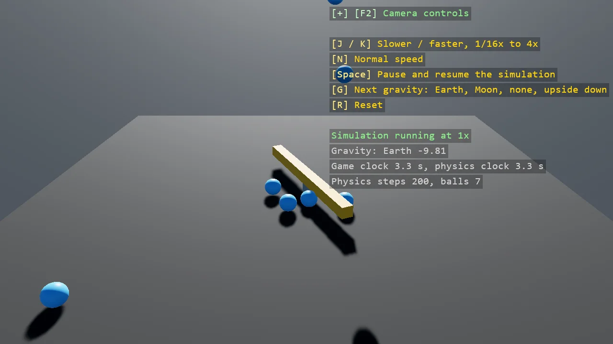

# Time Control

The simulation has a clock of its own, with three knobs: TimeScale runs it slower or faster than
the game, Enabled pauses it, and PoseGravity changes while it runs. A dropper releases a ball every
half second on the game clock while a kinematic bar spins on the physics clock, so slowing the
simulation queues balls in the air over a bar that barely turns, and pausing it hangs them there.
A component implementing ISimulationUpdate counts the physics steps, the simulation's clock read exactly.

The `Program.cs` file shows how to:

- BepuSimulation.TimeScale, Enabled and PoseGravity changed while the game runs
- The game clock and the physics clock side by side, and what runs on which
- A kinematic body turned by a velocity, so its motion follows the physics clock
- ISimulationUpdate on a component, called once per fixed step with the step's length
- MaxStepPerFrame, the cap that lets a fast simulation keep up with the clock
- Using helpers: SceneSetup3D, CreatePrimitive, AddGrabber, TextOverlay

View on [GitHub](https://github.com/stride3d/stride-community-toolkit/tree/main/examples/code-only/E05_3D_TimeControl).

[!code-csharp]